<a href="https://daivya4.github.io/daivyashah.github.io/">
  
</a>

<div align="center">

<br/>

**I build agents, cloud-native backends and full-stack products that ship.**
<br/>
<sub>CS @ BMS College · ex-intern at NatWest Group & Reliance Industries</sub>

<br/><br/>

[](https://daivya.me)
[](https://linkedin.com/in/daivyashah)
[](mailto:daivya444@gmail.com)

<br/>


</div>

<br/>

### ⚡ Featured

| | |
|---|---|
| **[ClarifySQL](https://github.com/daivya4/ClarifySQL)** | Plain English → safe, read-only SQL. FastAPI · SQLGlot · LLMs |
| **[Agent Eval Harness](https://github.com/daivya4/agent-eval-harness)** | Benchmarks coding agents with deterministic tests. FastAPI · React |
| **[Agentic Research Platform](https://github.com/daivya4/agentic_research_platform)** | Multi-agent web research & reports. LangGraph |
| **[AI Resume Analyzer](https://airesumind.vercel.app)** | ATS keyword-gap scoring + LLM suggestions. React · TypeScript |

<br/>

### 🛠️ Lately

```ts
const daivya = {
  building:  "AI agent workflows on AWS",
  exploring: ["LangGraph", "MCP servers", "Terraform"],
  lookingFor: "SWE / AI-ML roles · 2027",
};
```

<br/>

<div align="center">

<picture>
  <source media="(prefers-color-scheme: dark)" srcset="https://raw.githubusercontent.com/daivya4/daivya4/output/github-snake-dark.svg"/>
  <source media="(prefers-color-scheme: light)" srcset="https://raw.githubusercontent.com/daivya4/daivya4/output/github-snake.svg"/>
  
</picture>

<sub>✦ &nbsp;Let's build something. &nbsp;✦</sub>

</div>
